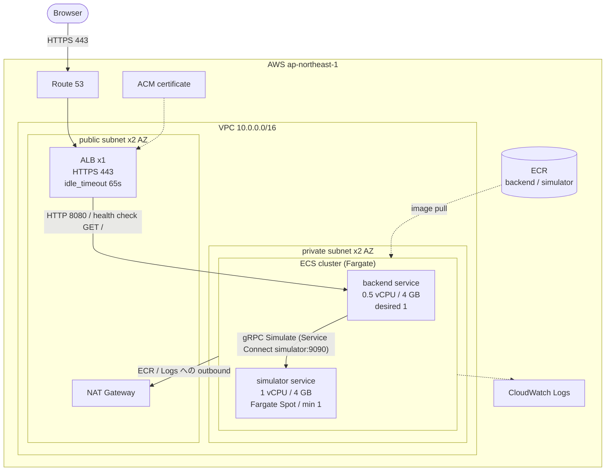

# AWS デプロイ構成

`apps/backend` と `apps/simulator` を AWS に配置するための構成図と、その構成を決めた根拠をまとめる。
アプリケーション内部の実行経路は [architecture.md](architecture.md) を参照すること。

前提:

- **認証なしの構成**。backend にはログイン機能が無く、すべての画面と API をログインなしで公開する。
- **RDBMS を使わない構成**。backend は DB を持たない。この前提が成り立つ条件は
  [永続化の前提](#永続化の前提) に記載する。

## 構成図



backend から simulator への 1 リクエストは gRPC の unary RPC（`SimulationService/Simulate`）で、
`SimulationCoordinator` が **30 秒**（gRPC のデッドライン）まで HTTP スレッドをブロックして応答を待つ。
超過は HTTP 504、その他の通信失敗は HTTP 502 になる。この 30 秒がタイムアウト系の設定値すべての基準になる。

図の読み方で誤解しやすい点を 3 つ補足する。

- **ALB は 1 台**である。`public subnet x2 AZ` は ALB が 2 台あるという意味ではなく、1 つの ALB が
  2 つの AZ にまたがって配置されていることを示す。ALB は作成時に異なる 2 AZ のサブネットを最低 2 つ
  要求するため、この x2 は削減できない。削減できるのは ECS タスク側の AZ 数である。
- **ECR・CloudWatch Logs は VPC の外にある**。同じ `AWS ap-northeast-1` の枠内に描いているのは
  同一リージョンのマネージドサービスであることを示すためで、VPC の内側にいるわけではない。
  private subnet からこれらを呼ぶには外向きの経路が必要で、それが NAT Gateway である。
  backend -> simulator の gRPC 呼び出しは VPC 内（ECS Service Connect）で完結し、NAT Gateway を経由しない。
  ECR・Logs への通信は NAT Gateway を経由する。
- **認証が無くても NAT Gateway は不要にならない**。上記の通り ECR・Logs への outbound が
  必要なため。NAT を無くす選択肢は [NAT Gateway の代替](#nat-gateway-の代替) を参照。

### NAT Gateway の代替

| 方法 | 月額 | 評価 |
| --- | --- | --- |
| NAT Gateway | 約 $35 | private subnet を維持でき、経路の説明が最も単純 |
| VPC エンドポイント（ECR api / ECR dkr / Logs の interface 3 種 + S3 gateway） | 約 $31〜62 | interface 型は 1 種あたり 1 AZ で月 $10 前後。この規模では NAT より高い |
| public subnet + パブリック IP、inbound は SG で全遮断 | $0 | private subnet が無くなる代わりに最も安い |

この規模では VPC エンドポイントは割に合わない。NAT を維持するか、全タスクを public subnet に置くかの
二択になる。

## リソース構成

`infra/aws-terraform/` に追加するファイル単位で示す。メッセージキューは使わないため、`sqs.tf` とその IAM ポリシーは存在しない。backend と simulator は
ECS Service Connect（`aws_service_discovery_http_namespace`）で接続する。

| ファイル | 内容 |
| --- | --- |
| `network.tf` | VPC、public/private subnet x2 AZ、IGW、NAT Gateway、SG 3 種（alb / backend / simulator。simulator は backend SG からの TCP 9090 のみ許可） |
| `ecr.tf` | repository x2、lifecycle policy（untagged 7 日・直近 30 イメージ）、イメージスキャン |
| `alb.tf` | ALB、ACM、HTTPS listener、HTTP→HTTPS リダイレクト、target group |
| `ecs.tf` | cluster（FARGATE + FARGATE_SPOT）、Service Connect namespace、task definition x2、service x2 |
| `iam.tf` | task execution role（ECR pull / Logs / `ssm:GetParameters`）、task role x2 |
| `autoscaling.tf` | simulator を CPU 使用率のターゲット追跡で 1→N にスケール |
| `observability.tf` | ロググループ x2（保持 14 日） |

RDBMS を使わないため、`rds.tf`・DB サブネットグループ・DB 用 SG・`DATABASE_*` の秘匿値管理は存在しない。

### ALB の設定値

| 設定 | 値 | 根拠 |
| --- | --- | --- |
| health check path | `GET /` | ログインなしで 200 を返すトップ画面 |
| `idle_timeout` | 65 秒 | 待機 30 秒 + アプリ処理に余裕を持たせる。既定 60 秒でも計算上は足りるが、境界に依存させない |
| `deregistration_delay` | 35 秒 | デプロイ時に待機中の 30 秒リクエストを落とさない |

### タスク定義の環境変数

| 変数 | backend | simulator | 供給元 |
| --- | --- | --- | --- |
| `SPRING_PROFILES_ACTIVE` | `prod` | `prod` | task definition |
| `SIMULATOR_GRPC_HOST` / `SIMULATOR_GRPC_PORT` | `simulator` / `9090` | — | task definition（Service Connect の client alias） |
| `SIMULATION_GRPC_PORT` | — | `9090` | task definition |

アプリケーションが必要とする秘匿値は無い。

## 永続化の前提

backend は DB を持たない。ログイン機能を削除したため、永続化対象だった `users` テーブルも存在しない。
**シミュレーション結果も DB に保存されない**（gRPC の応答を HTTP レスポンスで返すだけ）。
そのためタスク再起動で失われる永続データは無い。

シミュレーション結果の保存や履歴など、再起動後も保持すべきデータが要件になった時点で
RDS（PostgreSQL など）の追加を別の feature specification として検討する。

## この構成が受け入れている制約

構成図の `desired 1` や 30 秒のデッドラインはアプリケーション側の現在の実装から決まっている。

- **backend は 1 タスク固定**（費用上の選択）。結果の相関をタスクローカルに保持する仕組み
  （旧 `WaitingResultRegistry`）は gRPC 化で無くなったため、技術的には 2 タスク以上にできる。
  ただし画面は同期 HTTP を保持し続けるため、増やす場合は ALB のタイムアウトとの整合を確認する。
- **simulator の最小タスク数は 1**。0→1 の起動には 1〜2 分かかり、backend の 30 秒デッドラインに
  間に合わない。常時費用は Fargate Spot で抑える。Spot の中断で処理中のリクエストは
  gRPC エラー（HTTP 502）になり、キューによる再配信は無い。利用者の再実行で回復する。
- **simulator のスケールは CPU 使用率に基づく**（`simulator_cpu_target_percent`）。Service Connect は
  gRPC のリクエスト単位で simulator タスクへ負荷分散する。
- **task definition の改訂が必要**。task definition は `lifecycle.ignore_changes = [container_definitions]` のため、
  既存環境へ gRPC 化を適用するには `grpc` ポートマッピングと環境変数を含む新しい revision の登録が要る。

## デプロイ

`.github/workflows/release-ecr.yml` が release 公開時に `APP` build-arg で 2 イメージを ECR へ push 済み。
その後段に ECS へのデプロイジョブを追加する。

```text
release published
  -> build & push <repository>:<tag>          (既存)
  -> aws ecs register-task-definition          (image のみ差し替え)
  -> aws ecs update-service --force-new-deployment
```

Terraform 側の task definition には `lifecycle { ignore_changes = [container_definitions] }` を設定し、
インフラ（Terraform）とイメージタグ（CD）の所有者を分離する。分離しないと release のたびに
`plan-terraform-deployment.yml` の plan に差分が出る。

## 費用の目安

ap-northeast-1、月額の概算。

| 項目 | 標準 | コスト最適化 |
| --- | --- | --- |
| ALB | $20 | $20 |
| Fargate backend (0.5 vCPU / 4 GB 常時) | $35 | $35 |
| Fargate simulator (1 vCPU / 4 GB 常時) | $53 | $16（Spot） |
| NAT Gateway | $35 | $0（public subnet + パブリック IP、inbound は SG で遮断） |
| CloudWatch Logs / ECR | $2 | $2 |
| 合計 | 約 $145 | 約 $73 |

さらに下げる場合、EC2 1 台に既存の `compose.yaml` をそのまま載せる選択肢がある（月 $12〜15）。
backend が 1 タスク固定である制約は同じなので機能面の損失はほぼ無く、サービス単位のスケール、
無停止デプロイ、AZ 冗長を必要とするかどうかが判断基準になる。

## この文書の更新条件

- ECS サービス構成、ネットワーク、Service Connect・gRPC のパラメータを変更したとき
- backend の待機時間（gRPC デッドライン）や simulator のスケール設定を変更したとき
- 永続化要件が変わり RDBMS を追加したとき
